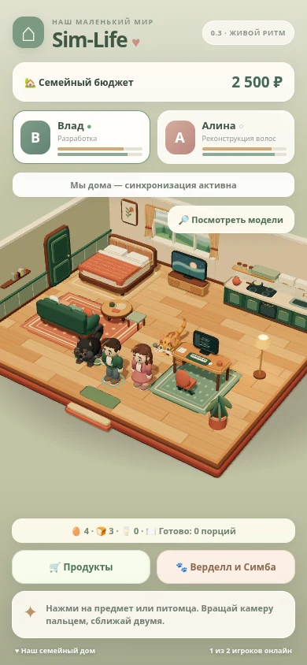
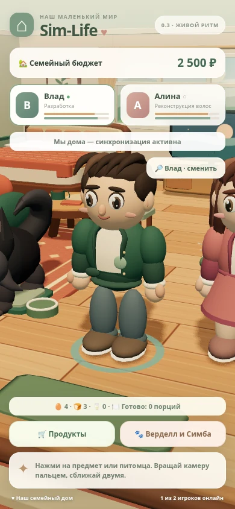
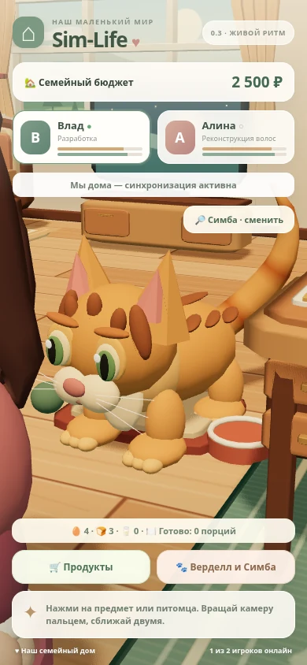

# Художественное направление Sim-Life

Это первый цельный проход по визуальному стилю дома. В портретном режиме игрок видит открытую диораму с тёплым дубом, штукатуркой, терракотой и тёмно-зелёными деталями. Ближний край остаётся открытым для обзора, а задние стены, оконный проём и порог объясняют устройство дома.

- **Палитра и зоны.** Дуб, орех и тёплая бумага связывают все зоны. Глубокий зелёный объединяет диван и кухню, терракота выделяет постель и рабочее кресло, а ковры отделяют места отдыха, сна и работы. Самые тёмные тона остаются у техники, волос и Верделла.
- **Форма и масштаб.** Скруглённые несущие детали, мягкие подушки и тканевые кромки читаются с высоты. Латунные ручки, рисунок плитки и текстиль заметнее при приближении. Декор опирается на пол, мебель или стену. Габариты мебели, точки поз и подходов сверяются до добавления выступающих деталей.
- **Свет и материалы.** Один направленный источник создаёт мягкие общие тени. Полусферический свет подсвечивает лица и тёмный мех, а торшер локально согревает рабочую сторону комнаты. Шероховатые ткани, сатиновое дерево, керамика и латунь используют общие материалы. Небольшая текстура тени привязывает основание к фону.
- **Герои и питомцы.** У Влада короткие изогнутые пряди и зелёная куртка, у Алины длинные каштановые локоны и розовые слои одежды. У Верделла тёмный объёмный воротник и завитой хвост, у Симбы оранжевый корпус, полосатый хвост и светлая мордочка. Движущиеся части собраны вокруг существующих шарниров.
- **Ассеты.** Пол, ковры, плитка, пейзаж, принт и экран рисуются при запуске с помощью Canvas 2D. Модели и рисунки созданы для проекта. Всё содержится в коде, у 3D-сцены нет сторонних файлов и загрузок текстур.

## Сравнение в 390 × 844

| До, исходная камера | После, та же позиция и угол камеры |
| --- | --- |
|  |  |

[Полный дом в новом портретном кадре](art-review/after.webp) · [Диван и спальная зона](art-review/living-sleep.webp) · [Кухня](art-review/kitchen.webp) · [Рабочий угол](art-review/work.webp)

| Влад | Алина | Верделл | Симба |
| --- | --- | --- | --- |
|  |  |  |  |

Снимки сделаны в Chromium с тестовым домом при 390 × 844 CSS-пикселях и DPR 1. Для сравнения версий использована исходная камера с FOV 46°, позицией (15, 19, 22) и целью (0, 0, 0). В штатном режиме новый портретный кадр показывает всё основание. Крупные планы мебели сняты отдельной камерой.

Следующий проход лучше начать с проверки производительности и читаемости на физических iPhone и Android. На устройствах стоит проверить границы теней при приближении и положение рук относительно столешницы во время готовки и работы.

## Бюджет сцены

| Chromium при одинаковой камере | До | После |
| --- | ---: | ---: |
| Меши в сцене | 589 | 291 |
| Меши, отбрасывающие тень | 108 | 74 |
| Источники света / карты теней | 3 / 1 | 3 / 1 |
| Вызовы отрисовки, включая тени | 694 | 364 |
| Треугольники, включая тени | 117 446 | 98 466 |
| Клиентский JS, gzip | 169,76 кБ | 173,05 кБ |

Данные отрисовки получены из `WebGLRenderer.info` после кадра в Chromium со SwiftShader. Это счётчики работы рендерера, а не замер FPS. Генерируемые текстуры занимают около 7,6 МиБ в виде RGBA8 с mip-уровнями. Снимки для ревью не входят в клиентскую сборку.
