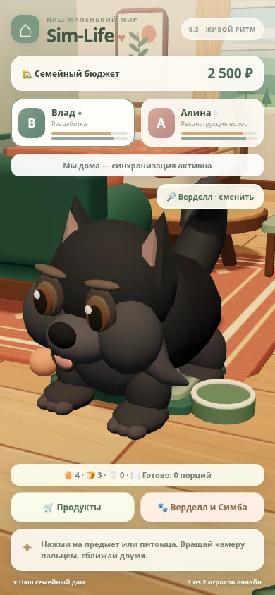
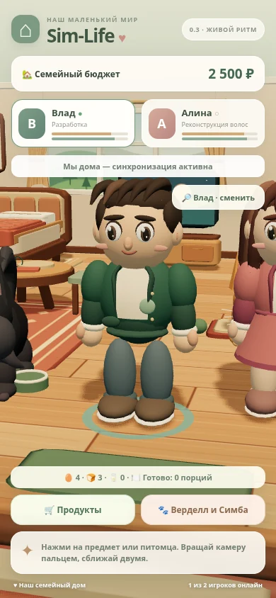
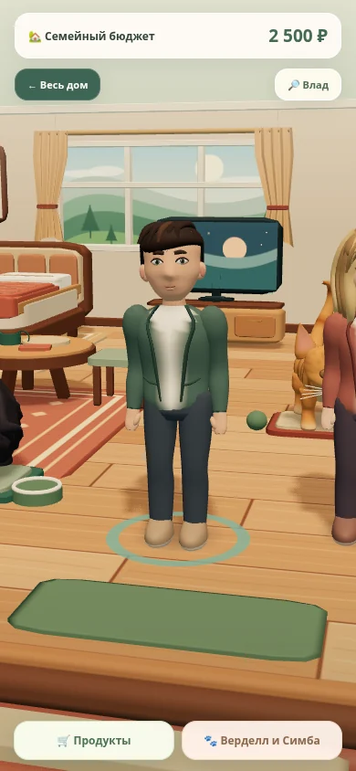

# Художественное направление Sim-Life

Это первый цельный проход по визуальному стилю дома. В портретном режиме игрок видит открытую диораму с тёплым дубом, штукатуркой, терракотой и тёмно-зелёными деталями. Ближний край остаётся открытым для обзора, а задние стены, оконный проём и порог объясняют устройство дома.

- **Палитра и зоны.** Дуб, орех и тёплая бумага связывают все зоны. Глубокий зелёный объединяет диван и кухню, терракота выделяет постель и рабочее кресло, а ковры отделяют места отдыха, сна и работы. Самые тёмные тона остаются у техники, волос и Верделла.
- **Форма и масштаб.** Скруглённые несущие детали, мягкие подушки и тканевые кромки читаются с высоты. Латунные ручки, рисунок плитки и текстиль заметнее при приближении. Декор опирается на пол, мебель или стену. Габариты мебели, точки поз и подходов сверяются до добавления выступающих деталей.
- **Свет и материалы.** Один направленный источник создаёт мягкие общие тени. Полусферический свет подсвечивает лица и тёмный мех, а торшер локально согревает рабочую сторону комнаты. Шероховатые ткани, сатиновое дерево, керамика и латунь используют общие материалы. Небольшая текстура тени привязывает основание к фону.
- **Герои и питомцы.** У Влада короткие изогнутые пряди и зелёная куртка, у Алины длинные каштановые локоны и розовые слои одежды. У Верделла тёмный объёмный воротник и завитой хвост, у Симбы оранжевый корпус, полосатый хвост и светлая мордочка. Движущиеся части собраны вокруг существующих шарниров.
- **Ассеты.** Пол, ковры, плитка, пейзаж, принт и экран рисуются при запуске с помощью Canvas 2D. Модели и рисунки созданы для проекта. Всё содержится в коде, у 3D-сцены нет сторонних файлов и загрузок текстур.

## Сравнение в 390 × 844

| До, исходная камера | После, та же позиция и угол камеры |
| --- | --- |
|  |  |

[Полный дом в новом портретном кадре](art-review/after.webp) · [Диван и спальная зона](art-review/living-sleep.webp) · [Кухня](art-review/kitchen.webp) · [Рабочий угол](art-review/work.webp)

| Влад | Алина | Верделл | Симба |
| --- | --- | --- | --- |
|  |  |  |  |

Снимки сделаны в Chromium с тестовым домом при 390 × 844 CSS-пикселях и DPR 1. Для сравнения версий использована исходная камера с FOV 46°, позицией (15, 19, 22) и целью (0, 0, 0). В штатном режиме новый портретный кадр показывает всё основание. Крупные планы мебели сняты отдельной камерой.

Следующий проход лучше начать с проверки производительности и читаемости на физических iPhone и Android. На устройствах стоит проверить границы теней при приближении и положение рук относительно столешницы во время готовки и работы.

## Бюджет сцены

| Chromium при одинаковой камере | До | После |
| --- | ---: | ---: |
| Меши в сцене | 589 | 291 |
| Меши, отбрасывающие тень | 108 | 74 |
| Источники света / карты теней | 3 / 1 | 3 / 1 |
| Вызовы отрисовки, включая тени | 694 | 364 |
| Треугольники, включая тени | 117 446 | 98 466 |
| Клиентский JS, gzip | 169,76 кБ | 173,05 кБ |

Данные отрисовки получены из `WebGLRenderer.info` после кадра в Chromium со SwiftShader. Это счётчики работы рендерера, а не замер FPS. Генерируемые текстуры занимают около 7,6 МиБ в виде RGBA8 с mip-уровнями. Снимки для ревью не входят в клиентскую сборку.

## Второй проход · модели, движение и мобильный осмотр

Персонажи перешли к более естественным пропорциям. Лица и одежда построены как цельные поверхности с управляемым профилем. Влад получил удлинённое лицо, короткие тёмные волосы и повседневный комплект с зелёной курткой. У Алины светло-русые объёмные волосы, мягкий взгляд и терракотовая куртка. Ориентиром были присланные фотографии и описания. Фотографии не добавлены в репозиторий и не используются как игровые текстуры.

Верделл получил многослойный воротник, маленькие уши и короткий хвост в форме стручка. У Симбы вытянутое тело, тонкие лапы и узор, окрашенный прямо на поверхности шерсти. Мордочка, уши и хвост каждого питомца анимируются отдельно.

- `SculptMesh.ts` строит лёгкие поверхности по сечениям и распределяет веса вокруг сгибов. У персонажа четыре двухзвенных конечности. Рукав или брючина проходят через стык, а ладони и обувь следуют за нижними сегментами.
- `Actor.ts` связывает шаг с пройденной дистанцией. Перенос веса, дыхание, наклоны и взгляд сглаживаются отдельно от перемещения по A*. В длинном кадре персонаж проходит повороты маршрута с тем же запасом дистанции, чтобы добраться до действия даже при редких кадрах. За рабочим столом и у плиты руки направлены к столешнице. Еда сохраняет посадку, а телесные реакции и ложка видны во время соответствующих действий. Ноги подгибаются на диване. Рукам, голове и корпусу заданы отдельные траектории для сна, объятий, «дай пять» и ухода за питомцами.
- `PetActor.ts` сохраняет питомцев у их мест и оживляет дыхание, моргание, уши и хвост. Игровые реакции короткие и плавно затухают. Короткий хвост Верделла остаётся небольшим и в движении.
- `InspectionFrame.ts` вписывает вершины модели в свободную область между панелями. При осмотре остаются бюджет, игровые меню, полоса текущей задачи и кнопка «Весь дом». Камера следует за выбранной моделью. Сенсорное вращение и масштабирование остаются в сцене.
- `ContactShade.ts` добавляет общую контактную подложку для мебели и одну переиспользуемую градиентную текстуру для героев и питомцев. После подстройки света остаются три светильника и одна карта теней. Точки подхода, общие данные, WebSocket и серверные таймеры остались прежними.

### Сравнение второго прохода · 390 × 844

Камера в каждой паре совпадает по положению, цели и FOV. В кадрах крупным планом виден реальный интерфейс осмотра каждой версии. Позиции сна, дивана и работы взяты из штатного восстановления позы; готовка запущена штатным клиентским действием в одноразовом тестовом доме.

| Сцена | До · `2a5c280` | После |
| --- | --- | --- |
| Общий план |  |  |
| Влад |  |  |
| Алина |  |  |
| Верделл |  |  |
| Симба |  |  |

| Действие | Кадр до | Кадр после |
| --- | --- | --- |
| На диване | [До](art-review-stage2/before-sit.webp) | [После](art-review-stage2/after-sit.webp) |
| Сон | [До](art-review-stage2/before-sleep.webp) | [После](art-review-stage2/after-sleep.webp) |
| Работа | [До](art-review-stage2/before-work.webp) | [После](art-review-stage2/after-work.webp) |
| Готовка | [До](art-review-stage2/before-cook.webp) | [После](art-review-stage2/after-cook.webp) |

[Кадры в покое, в движении и при объятии](art-review-stage2/motion.webp) · [Автоматический кадр режима осмотра](art-review-stage2/after-inspection.webp)

### Проверка и бюджет второго прохода

Сравнение выполнено в Chromium 156 со SwiftShader при 390 × 844 и DPR 1. Положение камеры дома (20,25; 27,1; 29,7), цель (0; 1,45; 0), FOV 46°. Счётчик вызовов включает отрисовку теней. Размер текстур оценён по формату и разрешению. Он не включает буферы экрана, карту глубины, память геометрии и внутренние буферы драйвера.

| Измерение | Первый проход | Второй проход |
| --- | ---: | ---: |
| Меши в сцене | 291 | 258 |
| Объекты, отбрасывающие тень | 74 | 68 |
| Источники света / карты теней | 3 / 1 | 3 / 1 |
| Вызовы отрисовки | 364 | 321 |
| Треугольники | 98 466 | 117 396 |
| Текстуры в счётчике WebGL | 12 | 22 |
| Генерируемые карты поверхностей | ~7,6 МиБ | ~7,95 МиБ |
| Клиентский JS, gzip | 173,05 кБ | 177,44 кБ |

Второй проход тратит меньше вызовов отрисовки и больше треугольников на цельные поверхности и деформацию одежды. Из десяти новых текстур две отвечают за контактные тени, восемь содержат матрицы костей и занимают около 2 КиБ суммарно.

`npm run build` и 31 тест пройдены. Chromium подтвердил сенсорный выбор шести предметов, Алины и обоих питомцев, вращение и pinch без ошибок JavaScript. Режим осмотра проверен на 390 × 844, 360 × 800, 412 × 915, 360 × 690 и desktop 1280 × 800. Узкое окно 360 × 690 приближает видимую высоту телефона с панелями браузера.

Следующему ревьюеру стоит проверить темп шага, звук и видимые границы контакта кистей на реальных iPhone и Android. Данные FPS, энергопотребления и работы Safari ещё не измерены. Художественную доводку портретного сходства и точный контакт пальцев с предметами можно продолжить после просмотра на устройствах.

## Мобильная компоновка после второго прохода

В портрете логотип и бюджет делят одну строку. Карточки игроков с двумя шкалами занимают следующую, статус и «Посмотреть модели» выведены рядом. Внизу остались запасы, две основные кнопки и короткая подсказка. Интерактивные элементы основных панелей сохраняют высоту 44 CSS-пикселя. Уведомления появляются возле верхнего HUD, а текущая задача с кнопкой отмены занимает компактную строку над нижними кнопками.

Камера дома рассчитывает ракурс по полезной полосе между постоянными панелями. В `HomeFrame.ts` горизонтальное кадрирование опирается на мебель и игровую зону. Свободные боковые края основания могут выйти за кадр, все шесть предметов остаются внутри. Высота стен и передняя ступень входят в расчёт по вертикали. Меню действий не меняет домашний ракурс. После поворота пальцем камера сохраняет выбранное положение при изменении высоты окна. У осмотра отдельная подгонка по габаритам модели и текущим панелям.

Полотно использует доступную высоту `100dvh`, а HUD учитывает поля `safe-area-inset` при `viewport-fit=cover`. Поле личного кода имеет шрифт 16 CSS-пикселей в портрете, чтобы Safari не увеличивал страницу при фокусе. Портретный профиль убирает размытие фона под панелями, ограничивает внутреннее разрешение WebGL коэффициентом 1,25 и использует карту теней 768 × 768. Профиль широкого экрана сохраняет 1,5 и 1024 × 1024.

Снимки 390 × 844 из Chromium с эмуляцией телефона и DPR 3 приведены к размеру окна. Сцена и интерфейс каждого снимка взяты из работающей игры.

| Дом до · `ff00f6a` | Дом после |
| --- | --- |
|  |  |

[Осмотр Алины](mobile-review/inspection.webp) · [Работа за компьютером](mobile-review/work.webp) · [Общий план во время задачи](mobile-review/work-home.webp) · [Эмуляция верхнего и нижнего отступов телефона](mobile-review/safe-area.webp)

| Chromium 390 × 844 | До | После |
| --- | ---: | ---: |
| Верхний / нижний HUD, CSS-пиксели | 296 / 186 | 136 / 105 |
| Полоса между HUD, CSS-пиксели | 362 | 604 |
| Высота проекции контура дома, CSS-пиксели | 282 | 373 |
| Высота Влада на экране в стартовой позиции, CSS-пиксели | 37 | 49 |
| Внутренний буфер WebGL | 585 × 1266 | 487 × 1055 |
| Карта теней | 1024 × 1024 | 768 × 768 |
| Вызовы отрисовки, включая тени | 321 | 319 |
| Треугольники, включая тени | 117 396 | 117 072 |

Счётчики получены на соответствующих стандартных камерах каждой версии. У нового профиля на 31% меньше пикселей в цветовом буфере и на 44% меньше текселей в карте теней. Это оценка нагрузки, измерений FPS на iPhone Safari или Android здесь нет.

Сборка и 33 теста прошли. Проверка в Chromium охватила 390 × 844, 393 × 852, 375 × 812, 360 × 800, 412 × 915, короткое окно 360 × 690 и узкое 320 × 700. При 390 × 844 дополнительно проверены отступы 47 и 34 px, сенсорный выбор всех шести предметов и обоих питомцев, четыре режима осмотра, поворот и щипок. Переключение на 1280 × 800 и назад восстановило соответствующий профиль рендера. Рабочая задача, её визуальная поза и отмена проверены с двумя подключениями к одному тестовому дому.
