# Blender, GLB и персонажи Sim-Life

Влад и Алина по умолчанию загружаются из локальных GLB. Для сравнения открой ту же страницу с параметром `?characters=procedural`. При ошибке загрузки или несовместимом риге игра выбирает прежнюю модель соответствующего персонажа. Дом, точки подхода и серверные команды общие для обоих режимов.

## Исходники и экспорт

- `art/characters/vlad.blend` и `art/characters/alina.blend` содержат редактируемые поверхности, материалы, арматуру, группы весов и активное действие `Blink`.
- `art/characters/model.py` задаёт исходные сечения и направляющие для нового профиля лица, век, волос, курток и обуви. Он строит в Blender пять редактируемых частей. Переданные фотографии служили визуальными ориентирами и в проект не включены.
- `generate.py` строит и сохраняет .blend и GLB. `export.py` экспортирует уже открытый .blend. `compact.py` складывает цвета и веса в нормализованные целочисленные атрибуты базового glTF. Для игры хватает стандартного GLTFLoader.
- `src/assets/characters/` содержит два игровых GLB. Vite добавляет к именам хеш при сборке. Blender нужен при подготовке ассетов.

Проверено на Blender 4.3.2 в облачной среде. Из корня репозитория экспортируй отредактированные сцены так:

```sh
blender --background art/characters/vlad.blend --python-exit-code 1 --python art/characters/export.py -- src/assets/characters/vlad.glb
blender --background art/characters/alina.blend --python-exit-code 1 --python art/characters/export.py -- src/assets/characters/alina.glb
npm run build
npm test
```

Пересборка сечений и весов из Python создаёт оба файла заново. Для проверки в отдельной папке передай `--source-dir` и `--output-dir`:

```sh
blender --background --factory-startup --python-exit-code 1 --python art/characters/generate.py -- vlad
blender --background --factory-startup --python-exit-code 1 --python art/characters/generate.py -- alina
```

Для ручной правки открой .blend, измени нужную поверхность в Edit Mode или веса арматуры в Weight Paint и сохрани сцену. При экспорте используются исходный кадр 1 и локальная ось костей +Y в glTF. Чтобы кисти и стопы сохраняли контакты, оставь точки сочленений на месте. Действие `Blink` должно содержать ключи формы `CloseLids`. Игровая улыбка использует форму `Smile`, а кости `EyeL` и `EyeR` направляют радужки. Правки сечений из Python сохраняются в `model.py`. Правки в интерфейсе Blender хранятся в самом .blend.

## Игровой риг и материалы

У каждого героя 18 костей и пять частей одного скина. Лица используют отдельные поверхности век и радужек, изменённые челюсть, скулы и профиль носа. У Влада укорочены виски и добавлена синяя куртка с настоящим проёмом. У Алины светлые S-образные пряди обрамляют лицо и следуют за отдельной костью волос. Рукава и брючины продолжаются через суставы. У обуви выделены подошва, носок и шнурки, а у кистей есть собственный скульптурный контур пальцев. Цвета и детали материалов хранятся в вершинах.

`BlenderCharacter.ts` проверяет метаданные, оси, цепи костей и клип моргания до передачи модели в `Actor.ts`. Кеш по URL хранит исходный ассет. Экземпляры делят геометрию и материалы, каждый герой имеет свои кости и одну текстуру матриц для всех пяти частей. Режим сравнения выбирается при загрузке страницы. В игровой сессии набор моделей живёт вместе со сценой.

Клип `Blink` задаёт движение век. Игра интерполирует его ключи и плавно подмешивает закрытые веки во сне. Ходьба, взгляды, сидение и движения у мебели управляют костями того же ассета через игровую систему поз. Для клавиатуры, посуды и «дай пять» сохранены мировые цели IK. Отдельные пальцы имеют геометрию и двигаются как часть кисти. Физика ткани и волос для этого рига не требуется.

Верделл и Симба используют текущие риги. У них уже есть выразительные формы и реакции. Для переноса понадобится отдельный четырёхлапый риг с проверкой короткого хвоста и воротника Верделла, корпуса и полос Симбы. Улучшение от такого переноса пока не подтверждено сравнением в игре.

## Первый проход · сравнение из игры

Кадры ниже относятся к коммиту `d8bc98c`. Снимки 390 × 844 сделаны с одинаковыми камерами и FOV. Герои стоят в одинаковых точках. Для поз использованы те же игровые действия и фазы. В обоих режимах выбран системный шрифт.

| Ракурс | Процедурные модели | GLB |
| --- | --- | --- |
| Дом | 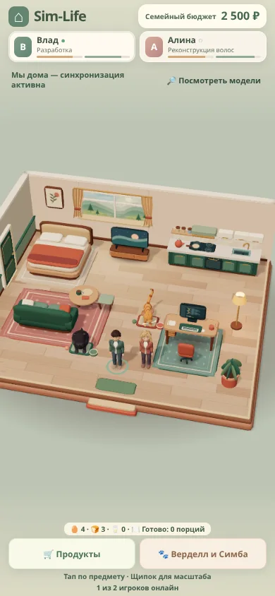 |  |
| Влад крупно | 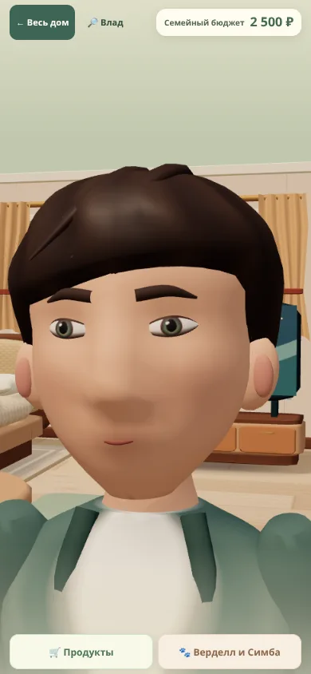 | 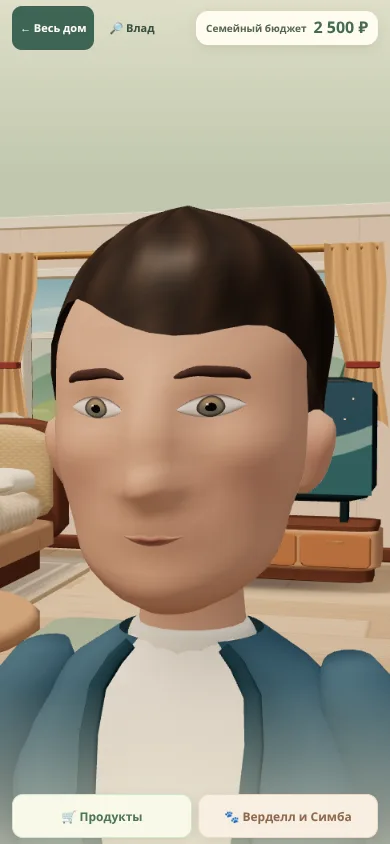 |
| Влад в полный рост | [До](blender-review/procedural-vlad-full.webp) | [После](blender-review/blender-vlad-full.webp) |
| Влад в профиль | [До](blender-review/procedural-vlad-side.webp) | [После](blender-review/blender-vlad-side.webp) |
| Алина крупно | 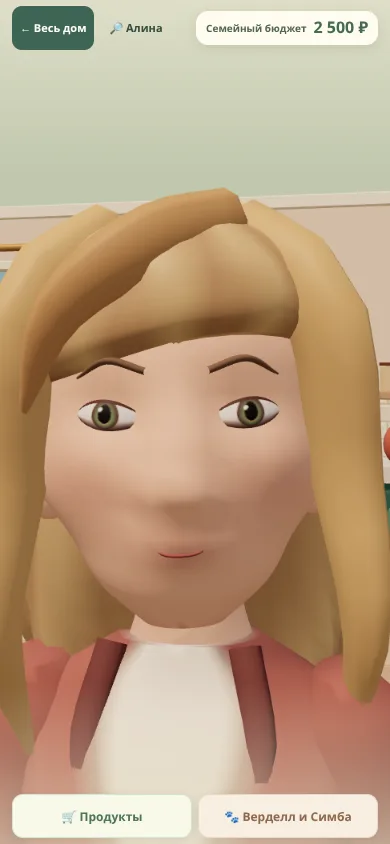 | 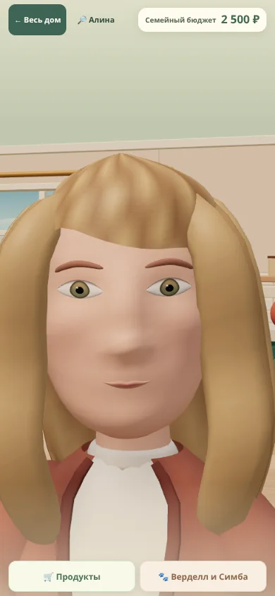 |
| Алина в полный рост | [До](blender-review/procedural-alina-full.webp) | [После](blender-review/blender-alina-full.webp) |
| Алина в профиль | [До](blender-review/procedural-alina-side.webp) | [После](blender-review/blender-alina-side.webp) |

| Действие | До | После |
| --- | --- | --- |
| Ходьба | [До](blender-review/procedural-walk.webp) | [После](blender-review/blender-walk.webp) |
| Отдых | [До](blender-review/procedural-sit.webp) | [После](blender-review/blender-sit.webp) |
| Сон | [До](blender-review/procedural-sleeping.webp) | [После](blender-review/blender-sleeping.webp) |
| Работа | [До](blender-review/procedural-working.webp) | [После](blender-review/blender-working.webp) |
| Готовка | [До](blender-review/procedural-cook.webp) | [После](blender-review/blender-cook.webp) |
| Еда | [До](blender-review/procedural-eat.webp) | [После](blender-review/blender-eat.webp) |
| Ласка | [До](blender-review/procedural-pet.webp) | [После](blender-review/blender-pet.webp) |
| Объятие | [До](blender-review/procedural-hug.webp) | [После](blender-review/blender-hug.webp) |
| «Дай пять» | [До](blender-review/procedural-high-five.webp) | [После](blender-review/blender-high-five.webp) |

[Подход, объятие и возвращение в обычную позу](blender-review/blender-sequence.webp)

## Стоимость рендера

Chromium 156 со SwiftShader, 390 × 844, DPR устройства 3. Измерен кадр стандартной камеры дома с тенями. Позиция камеры (5,56; 21,09; 22,80), цель (0,49; 0,38; −0,44), FOV 46°. Счётчики не являются измерением FPS телефона.

| Метрика | Процедурные модели | GLB |
| --- | ---: | ---: |
| Вызовы отрисовки | 260 | 214 |
| Треугольники, включая тени | 111 274 | 116 610 |
| Меши | 207 | 172 |
| Материалы | 113 | 103 |
| Объекты, отбрасывающие тень | 60 | 49 |
| Текстуры в счётчике WebGL | 29 | 21 |
| Данные атрибутов и индексов геометрий | 1,79 МиБ | 1,84 МиБ |
| Буфер WebGL | 487 × 1055 | 487 × 1055 |
| Карта теней | 768 × 768 | 768 × 768 |

В GLB Влада 13 370 треугольников, в GLB Алины 16 186. Объединение поверхностей в несколько частей снижает число вызовов. Часть работ с тенями переносится на общую геометрию кожи и одежды, поэтому суммарное число треугольников в кадре немного выше. Два GLB добавляют около 0,81 МиБ к первой загрузке. Вес указан без HTTP-сжатия. Размеры данных геометрии не включают JavaScript, полный кеш GLB и буферы GPU.

## Проверки

- Оба GLB воспроизводятся побайтно из .blend и при полном запуске генератора. Khronos glTF Validator вернул ноль ошибок и предупреждений.
- `npm run build` и все 37 тестов прошли. Новые тесты импортируют оба GLB, проверяют независимые экземпляры костей, проигрывание моргания, контакт кистей с клавиатурой и возврат фигуры к навигационному корню. Vite по-прежнему предупреждает о размере основного JS-чанка. Он занимает 196,06 кБ gzip, отложенный модуль GLTFLoader — 14,46 кБ gzip.
- В собранной версии локальный сервер отдал оба GLB. Проверены вход в игру с обоими ассетами, автоматический выбор старого Влада при HTTP 404 и переключатель процедурных моделей. В режиме сравнения запросов GLB нет.
- В Chromium на 390 × 844 проверены девять целей касания, включая мебель, Алину и двух питомцев, поворот, pinch-to-zoom, осмотр и возврат к дому. Рабочая задача запускается и отменяется. Два подключения получили объятие и «дай пять» через WebSocket. Ласка Верделла прошла через серверную задачу. Вход и осмотр также проверены на 360 × 690, 412 × 915 и 320 × 700. Ошибок JavaScript в этих сценариях не было.
- Физические iPhone и Android для этого прохода недоступны. Перед оценкой плавности на телефоне нужны замеры первой загрузки, длительной игры и отзывчивости сенсорного управления.

## Character Art Master Pass

Исходный коммит для этого прохода — `d8bc98c`. Для Влада и Алины заново построены линия челюсти, объём черепа и переходы у висков, скул и шеи. Переносица, крылья носа, углубления ноздрей и область вокруг губ входят в общий рельеф лица. У губ отдельно читаются верхняя дуга и нижняя губа. Оттенки век, носа и щёк записаны в вершины. Фотографии использованы как ориентиры для формы лица и волос.

- **Глаза и мимика.** Белок и радужка образуют криволинейную поверхность в глазнице. Радужки поворачиваются на существующих костях. Верхнее и нижнее веки смыкаются по поверхности глаза через форму `CloseLids`. Экспортированный клип `Blink` задаёт два коротких моргания, а во сне контроллер удерживает веки закрытыми. Форма `Smile` поднимает уголки губ и щёки. Вес улыбки возрастает при объятии, «дай пять» и игре с питомцем, затем возвращается к спокойному выражению.
- **Волосы.** У Влада укорочен переход к вискам, линия роста подчинена направлению укладки и пробора. У Алины большая поверхность от макушки до затылка формирует общий объём. Более тонкие пряди обрамляют лицо, а контур концов меняется по длине. Матовый материал и цветовые переходы подчёркивают направление прядей. Нижняя часть следует за костью волос.
- **Движение.** Голова немного опережает повороты маршрута, а взмах рук затихает перед остановкой. При работе взгляд переводится между клавиатурой и экраном. Кисти по-прежнему следуют мировым целям. Уточнены движение ложки над сковородой, положение опорной руки и наклон головы при объятии. Опора стопы на прямом шаге, навигационный корень и серверные таймеры сохранены.
- **Материалы и комната.** У кожи, ткани, волос, дерева и металла приглушены зеркальные блики. Контактные тени сведены к более мягкому внешнему пятну и плотной области у поверхности. Волосы и одежда формируют силуэт теней героев. Мелкие участки кожи получают тени в основном проходе. Позиции и параметры источников света, камера и профиль рендера одинаковы в обеих версиях.

### Сравнение при 390 × 844

Кадры сняты в игре с тем же положением персонажей, камерой, FOV и светом. Крупные планы фиксируют открытые веки и нейтральное выражение. Кадры действий сняты на соответствующих фазах маршрута и движения.

| Ракурс | `d8bc98c` | Финальный проход |
| --- | --- | --- |
| Дом | 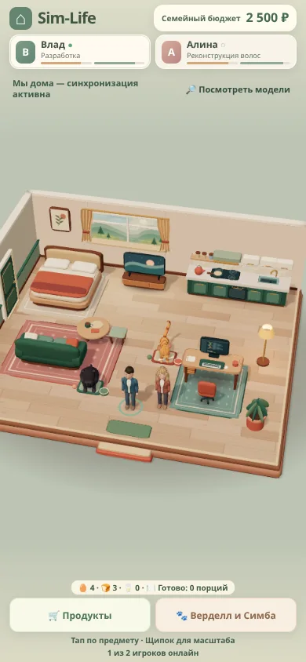 | 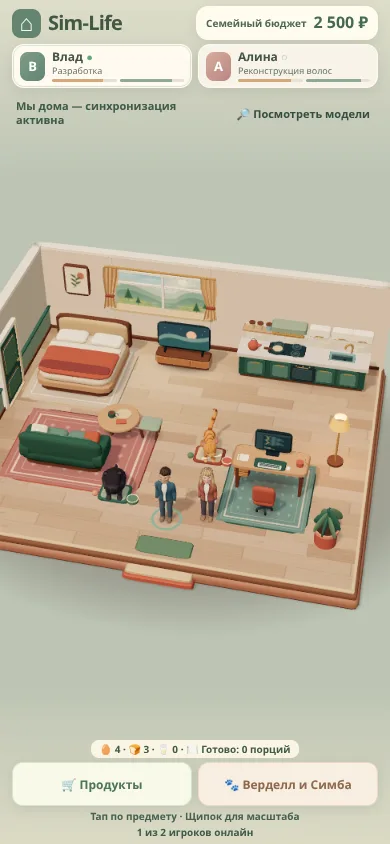 |
| Влад анфас | 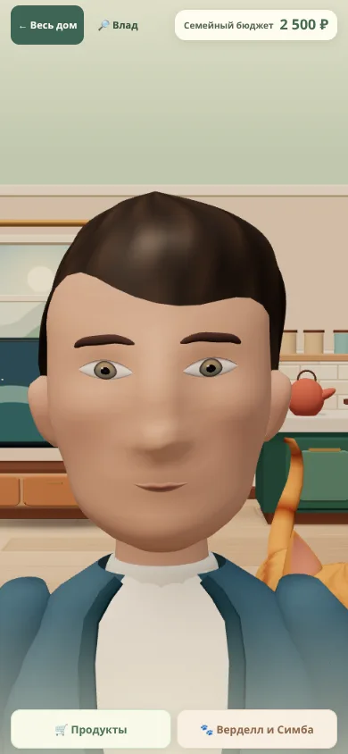 | 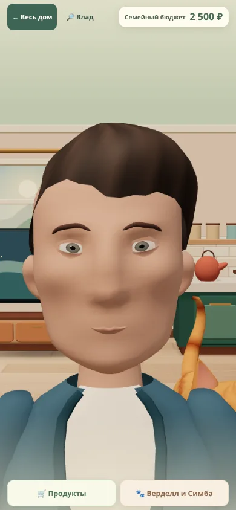 |
| Влад в три четверти | [До](character-master/before-vlad-quarter.webp) | [После](character-master/after-vlad-quarter.webp) |
| Влад в профиль | [До](character-master/before-vlad-profile.webp) | [После](character-master/after-vlad-profile.webp) |
| Влад сзади | [До](character-master/before-vlad-rear.webp) | [После](character-master/after-vlad-rear.webp) |
| Влад в полный рост | [До](character-master/before-vlad-full.webp) | [После](character-master/after-vlad-full.webp) |
| Алина анфас | 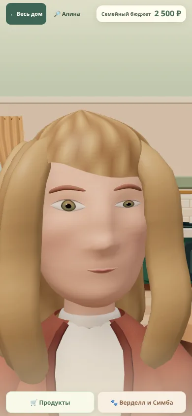 | 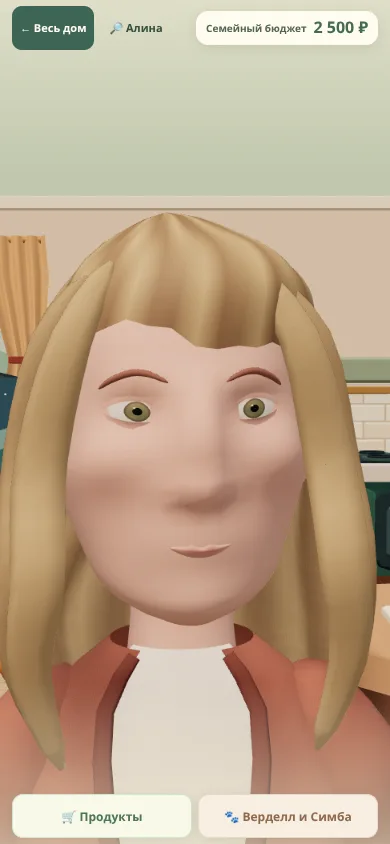 |
| Алина в три четверти | [До](character-master/before-alina-quarter.webp) | [После](character-master/after-alina-quarter.webp) |
| Алина в профиль | [До](character-master/before-alina-profile.webp) | [После](character-master/after-alina-profile.webp) |
| Алина сзади | [До](character-master/before-alina-rear.webp) | [После](character-master/after-alina-rear.webp) |
| Алина в полный рост | [До](character-master/before-alina-full.webp) | [После](character-master/after-alina-full.webp) |

| Действие | До | После |
| --- | --- | --- |
| Ходьба | [До](character-master/before-walk.webp) | [После](character-master/after-walk.webp) |
| Работа | [До](character-master/before-work.webp) | [После](character-master/after-work.webp) |
| Готовка | [До](character-master/before-cook.webp) | [После](character-master/after-cook.webp) |
| Еда | [До](character-master/before-eat.webp) | [После](character-master/after-eat.webp) |
| Сидение | [До](character-master/before-sit.webp) | [После](character-master/after-sit.webp) |
| Сон | [До](character-master/before-sleep.webp) | [После](character-master/after-sleep.webp) |
| Объятие | [До](character-master/before-hug.webp) | [После](character-master/after-hug.webp) |
| «Дай пять» | [До](character-master/before-high-five.webp) | [После](character-master/after-high-five.webp) |

[Моргание и улыбка Влада](character-master/vlad-expression.webp) · [Моргание и улыбка Алины](character-master/alina-expression.webp) · [Шаг, объятие и возврат в покой](character-master/after-sequence.webp)

### Портретный бюджет

Chromium 156 со SwiftShader, 390 × 844, DPR устройства 3. Замерен тот же штатный кадр дома с тенями. Размеры данных геометрии здесь включают морфы обеих версий и считают общие массивы один раз. Поэтому исходное значение немного выше значения в таблице первого прохода.

| Метрика | `d8bc98c` | Финальный проход |
| --- | ---: | ---: |
| Вызовы отрисовки | 214 | 212 |
| Треугольники с тенями | 116 610 | 107 742 |
| Меши | 172 | 172 |
| Материалы | 103 | 103 |
| Объекты с отбрасываемой тенью | 49 | 47 |
| Текстуры в счётчике WebGL | 21 | 23 |
| Атрибуты, индексы и морфы | 1,85 МиБ | 2,06 МиБ |
| WebGL-буфер | 487 × 1055 | 487 × 1055 |
| Карта теней | 768 × 768 | 768 × 768 |
| Два GLB | 850 КБ | 898 КБ |

Два морфа на героя добавляют данные и по одной текстуре морфов в WebGL. Количество костей остаётся 18 на персонажа. Передача теневого силуэта одежде и волосам сокращает число треугольников в теневом проходе. Выделенного постпроцессинга и дополнительных источников света в кадре нет.

### Проверка финального прохода

- `npm run build` и все 37 тестов прошли. Ассеты воспроизводятся побайтно из .blend и из Python. Khronos glTF Validator вернул ноль ошибок и предупреждений для обоих GLB.
- Тесты проверяют настоящие импортированные морфы и геометрию. Луч проходит к открытому зрачку, а при закрытии сначала попадает в веко. Проверены клип моргания, закрытие глаз во сне, улыбка при объятии, независимость экземпляров, контакт кистей с клавиатурой и опора стопы. Тайм-ауты серверных тестов не менялись.
- На 390 × 844 в Chromium проверены выбор касанием, поворот, pinch zoom, осмотр с возвратом к дому, запуск и отмена работы, ласка Верделла, объятие и «дай пять» на двух подключениях. Вход, портретный профиль и осмотр проверены также на 360 × 690, 412 × 915 и 320 × 700. Ошибок JavaScript в этих сценариях не было.
- Производственная сборка загрузила оба GLB. При имитации 404 для Влада сработал индивидуальный fallback. Режим `?characters=procedural` не запрашивает GLB.
- Мимика охватывает моргание, направление взгляда и улыбку, у кистей остаётся общий сустав без анимации каждого пальца. На физических iPhone и Android ещё нужно измерить первую загрузку, плавность и нагрев в длительной игре и посмотреть контакты в экстремальных позах. Счётчики Chromium относятся к нагрузке рендера. Vite по-прежнему предупреждает о размере основного чанка.
